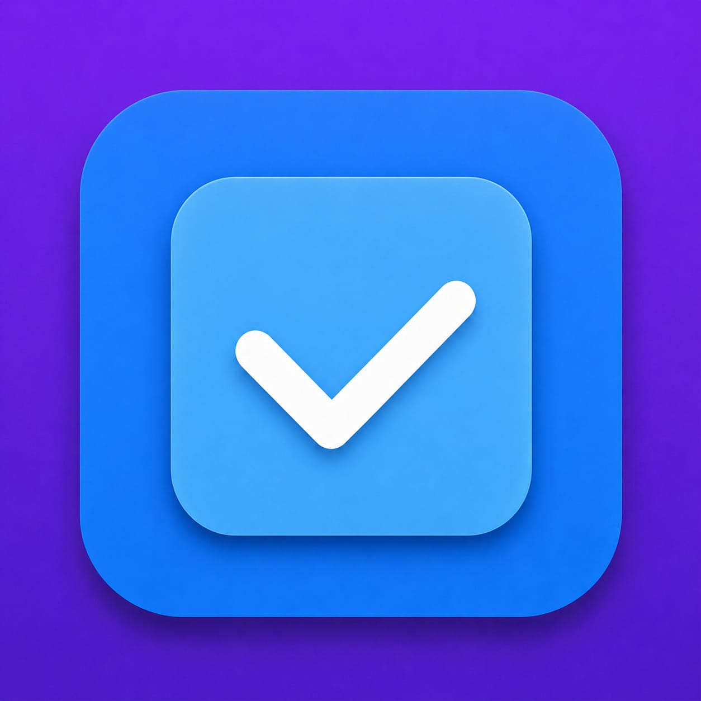

<div align="center">
  
  <h1>CoreBoard</h1>
  <p>
    Organização operacional, anotações inteligentes e execução diária — desenvolvido pela
    <a href="https://anchorlabstudio.com.br/"><strong>AnchorLab Studio</strong></a>.
  </p>
  <p>
    <a href="https://coreboard.anchorlabstudio.com.br">
      
    </a>
    <a href="https://github.com/ePedroBorges/coreboard/releases/latest/download/CoreBoard-Android.apk">
      
    </a>
    <a href="https://github.com/ePedroBorges/coreboard/releases/latest/download/CoreBoard-Setup-Windows.exe">
      
    </a>
    <a href="https://github.com/ePedroBorges/coreboard/releases">
      
    </a>
  </p>
</div>

---

## Acesso Rápido e Downloads

Use o **CoreBoard** diretamente no navegador ou instale no seu celular Android e computador Windows com sincronização na mesma conta.

| Plataforma | Acesso / Download | Como usar |
|---|---|---|
| **Web (Navegador)** | [https://coreboard.anchorlabstudio.com.br](https://coreboard.anchorlabstudio.com.br) | Acesso instantâneo em qualquer navegador (desktop ou mobile), sem precisar instalar nada. |
| **Android (`.apk`)** | [Baixar CoreBoard-Android.apk](https://github.com/ePedroBorges/coreboard/releases/latest/download/CoreBoard-Android.apk) | Baixe o `.apk` no celular e toque para instalar. Se o Android solicitar, habilite **"Instalar apps desconhecidos"** para o seu navegador ou gerenciador de arquivos. |
| **Windows (`.exe`)** | [Baixar CoreBoard-Setup-Windows.exe](https://github.com/ePedroBorges/coreboard/releases/latest/download/CoreBoard-Setup-Windows.exe) | Instalador Windows x64 (NSIS) com atalho na Área de Trabalho e no Menu Iniciar. Caso o Windows SmartScreen exiba aviso por ser um instalador independente, clique em **"Mais informações" → "Executar assim mesmo"**. |

> Todas as versões e histórico de lançamentos também ficam disponíveis na página de [Releases do repositório](https://github.com/ePedroBorges/coreboard/releases).

---

## Sobre o Projeto e a AnchorLab Studio

A **[AnchorLab Studio](https://anchorlabstudio.com.br/)** é uma empresa focada em aumentar a eficiência e o lucro dos clientes por meio de melhoria de processos, organização operacional e inteligência artificial aplicada.

O **CoreBoard** nasce dessa visão: tirar ideias, decisões e demandas soltas do caos diário e transformá-las em um fluxo simples de **captura → organização → execução**, disponível tanto no navegador quanto em aplicativos dedicados para Android e Windows.

---

## Para Quem é o CoreBoard (Personas)

### 1. Gestores, Empreendedores e Consultores
Centralize atas de reuniões, alinhamentos e decisões por cliente ou projeto dentro de pastas dedicadas e transforme pontos discutidos diretamente em tarefas com data de entrega, responsável e prioridade.

### 2. Analistas de Operações e Processos
Divida demandas complexas em subtarefas objetivas, acompanhe metas quantitativas (`concluído/quantidade`) e mantenha visibilidade diária do que está pendente e do que já foi entregue.

### 3. Profissionais Autônomos, Criadores e Estudantes
Tenha um segundo cérebro unificado com captura instantânea, tags, anotações fixadas, modo foco livre de distrações e continuidade de trabalho mesmo quando estiver sem internet.

---

## Principais Funcionalidades

- **Tela Hoje (`/hoje`):** barra de captura rápida para registrar anotações ou tarefas em segundos (`Ctrl+Enter`), além de reunir as prioridades pendentes do dia e as anotações recentes ou fixadas.
- **Gestão de Tarefas e Calendário (`/tarefas`):** planejamento por dia em calendário mensal, filtros rápidos (*Por dia*, *Pendentes*, *Concluídas*, *Todas*), prioridades (*Baixa*, *Média*, *Alta*), campo de responsável, progresso numérico (`progresso/quantidade`), subtarefas e seleção múltipla para ações em massa (mover pasta, fixar ou excluir).
- **Pastas, Subpastas e Editor de Anotações (`/anotacoes`):** organize conteúdos em pastas e subpastas com editor rico em formatação (negrito, itálico, sublinhado, tachado, marcador colorido, tamanho de fonte, listas e caixa de seleção inline), tags, favoritos, modo foco e criação de tarefas vinculadas diretamente à anotação de origem.
- **Busca Global e Atalhos (`Ctrl+K`):** paleta de comandos para navegar rapidamente entre pastas, anotações, tarefas e ações de criação.
- **Funcionamento Offline e Sincronização:** alterações feitas sem internet ficam armazenadas localmente no dispositivo e são sincronizadas automaticamente quando a conexão retorna.
- **Gamificação e Treinamento (`/conquistas`, `/curso`):** sistema de níveis (Bronze a Mestre) com XP por tarefas, subtarefas e anotações concluídas, além de uma central de treinamento introdutória com avaliação e certificado interno em PDF.
- **Personalização, Indicadores e Backup (`/dashboard`, `/configuracoes`):** modo claro e escuro, biblioteca de temas, fontes, feedback sonoro, opção de reduzir animações, painel de indicadores de produtividade e exportação/importação de backup em JSON (*mesclar* ou *substituir*).

---

## Planos (Free e Pro)

| Plano | Valor | O que está incluído |
|---|---|---|
| **Free** | **R$ 0** para sempre | Anotações, pastas e subpastas, tarefas e planejamento diário, links e checklists, busca global e backup JSON básico. |
| **Pro Mensal** | **R$ 9,90** / mês | Todos os recursos Free + biblioteca completa de temas premium, efeitos visuais avançados e sons, lembretes locais de tarefas no Android, anexos de imagem e PDF e exportação/compartilhamento em PDF. |
| **Pro Anual** | **R$ 69,90** / ano *(economize 41%)* | Todos os benefícios do plano Pro com cobrança anual. |
| **Pro Vitalício** | **R$ 89,90** *(pagamento único)* | Acesso vitalício a todos os recursos Pro sem mensalidades. |

---

## Como Começar em 2 Minutos

1. Acesse **[https://coreboard.anchorlabstudio.com.br](https://coreboard.anchorlabstudio.com.br)** pelo navegador (ou baixe o app para [Android (.apk)](https://github.com/ePedroBorges/coreboard/releases/latest/download/CoreBoard-Android.apk) / [Windows (.exe)](https://github.com/ePedroBorges/coreboard/releases/latest/download/CoreBoard-Setup-Windows.exe)).
2. Crie sua conta informando seu **e-mail e senha** e entre no workspace.
3. Na tela **Hoje**, escreva sua primeira anotação ou tarefa na barra de captura rápida.
4. Organize suas áreas em **Pastas** e acompanhe a execução diária pelo calendário e listas em **Tarefas**.

---

<details>
<summary><strong>Para Desenvolvedores — Stack, Build Local e Publicação de Releases</strong></summary>

### Stack Tecnológica
- **Frontend:** React 18, TypeScript, Vite, Tailwind CSS e shadcn/ui
- **Backend & Autenticação:** Supabase (PostgreSQL com RLS, Auth, Storage e Edge Functions)
- **Pagamentos:** Stripe
- **Mobile & Desktop:** Capacitor 8 (Android) e Electron 43 (Windows NSIS)

### Comandos de Desenvolvimento e Empacotamento

```sh
# Instalar dependências
npm install

# Rodar servidor de desenvolvimento web
npm run dev

# Gerar build web de produção
npm run build

# Gerar APK Android (requer Android SDK e Java configurados)
npm run package:android

# Gerar instalador Windows (.exe)
npm run package:windows

# Gerar Android + Windows
npm run package:all
```

### Publicação Automática de Releases
O workflow [`.github/workflows/release.yml`](./.github/workflows/release.yml) gera automaticamente `CoreBoard-Android.apk` e `CoreBoard-Setup-Windows.exe` na nuvem via GitHub Actions e publica ambos na GitHub Release sempre que uma tag `v*` é enviada (ou por execução manual em `Actions`).

</details>

---

## AnchorLab Studio

- **Aplicativo Web:** [https://coreboard.anchorlabstudio.com.br](https://coreboard.anchorlabstudio.com.br)
- **Site Oficial:** [https://anchorlabstudio.com.br/](https://anchorlabstudio.com.br/)
- **LinkedIn:** [AnchorLab Studio](https://www.linkedin.com/company/anchorlab)
